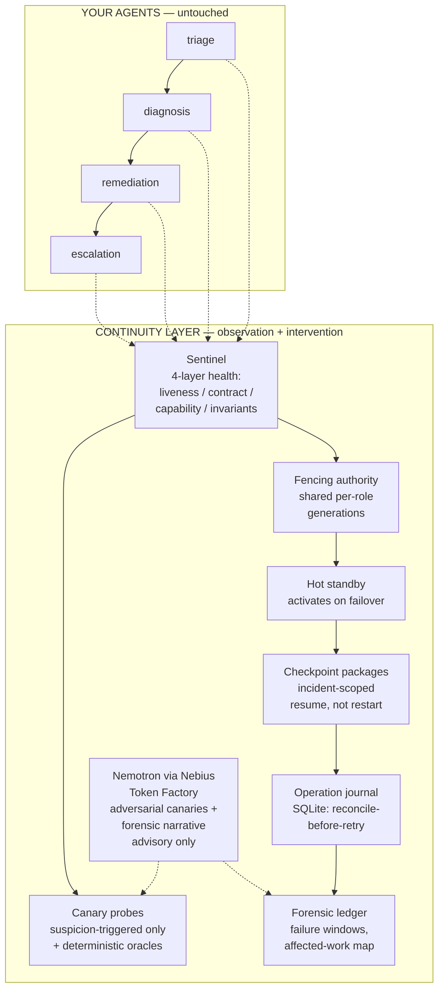

# Agent Continuity OS — architecture

A reusable resilience layer for autonomous AI workflows. It sits
*underneath* an existing workflow without modifying the agents: the
layer observes inputs, outputs, and effects, and intervenes only on
failure.

## The failure path (the core loop)

1. **Detect.** The Sentinel evaluates every role's output against its
   contract, capability probes, and business invariants, with
   hysteresis (HEALTHY → DEGRADED → QUARANTINED → FAILOVER → RECOVERING
   → REJOIN) so one bad output never causes flapping.
2. **Fence.** The fencing authority rotates the role's shared
   generation. The failed primary AND any previously-authorized standby
   lose write authority in a single step — no separate revoke to
   forget. The store checks the generation inside its own lock,
   atomically with the commit.
3. **Resume.** The hot standby activates with the failed incident's
   own checkpoint package (incident-scoped slots — never another
   incident's state) and resumes mid-workflow. Completed actions are
   skipped via idempotency keys; nothing is redone.
4. **Reconcile.** For lost acknowledgements, the SQLite journal marks
   the operation "unknown" and reconcile-before-retry reuses the
   committed receipt instead of re-executing.
5. **Verify.** Recovery probes must pass before the original agent
   rejoins at a new generation. Until then, the standby stays
   authoritative.
6. **Record.** The forensic ledger keeps the failure window, the
   affected-work map, duplicates prevented, and the full timeline —
   readable via the MCP interface and the dashboard.

## What Nemotron does (and does not do)

- DOES: invent adversarial canary probe scenarios per role
  (`NemotronCanaryGenerator`); write the advisory forensic narrative
  (`diagnostician.incident_narrative()`). Both are consumed by the
  deterministic pipeline: generated scenarios are judged by
  deterministic oracles, and the narrative is labelled advisory-only.
- DOES NOT: decide anything. All safety decisions — detection,
  fencing, blocking, rejoin — are deterministic contracts and oracles.
  On any model failure, the layer silently falls back to frozen static
  canaries and the stub diagnostician. The client never raises into the
  sentinel path.

## Integration boundary (honest)

- **No agent modification required.** Agents are wrapped at the
  `register` / `invoke` / `apply_effects` boundary (`examples/wrap_existing.py`).
- **What wrapping means:** the workflow must route agent invocations
  and side-effect applications through the layer. Agents that write
  directly to external systems bypass fencing — the layer can only
  guard effects it sees.
- **Side effects must carry idempotency keys** for exactly-once
  resume; the store enforces this.
